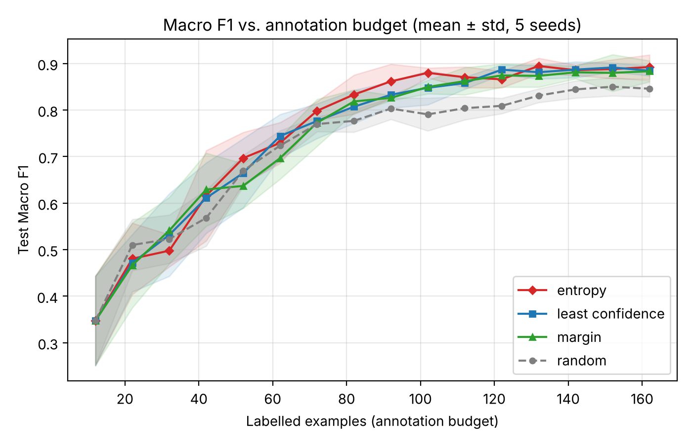

# Uncertainty-Driven Active Learning for Human-in-the-Loop NLP Annotation

[](https://github.com/nadeem015/active-learning-annotation/actions/workflows/ci.yml)


Labelling text data is slow and expensive. **Active learning** cuts the cost by letting the model choose which examples a human should label next: the ones it is *least certain* about. This project is a full research prototype of that loop. It includes a FastAPI backend, a browser annotation interface, a database that tracks every cycle, and an experiment runner that compares query strategies under equal labelling budgets.

```
Unlabelled pool ─▶ Train ─▶ Predict ─▶ Score uncertainty ─▶ Select batch ─▶ Human labels
      ▲                                                                       │
      └──────────────────────── Retrain & evaluate ◀───────────────────────────┘
```

## Results

The experiment used 600 synthetic customer-feedback sentences (3 classes) with a 30% held-out test set. Each run starts from 12 seed labels and adds 10 labels per cycle for 15 cycles. Results are averaged over **5 random seeds**.



| Strategy | Area under the F1 curve | F1 at 102 labels | F1 at 162 labels |
|---|---|---|---|
| **Entropy** | **0.752 ± 0.028** | **0.880 ± 0.010** | **0.892 ± 0.026** |
| Least confidence | 0.745 ± 0.025 | 0.848 ± 0.037 | 0.885 ± 0.011 |
| Margin | 0.740 ± 0.004 | 0.850 ± 0.015 | 0.883 ± 0.023 |
| Random (baseline) | 0.717 ± 0.012 | 0.791 ± 0.035 | 0.846 ± 0.018 |

- All three uncertainty strategies beat random sampling once they have about 70 labels.
- With 102 labels, entropy sampling reaches an F1 that random sampling **does not reach even with 162 labels**. That is the same quality for less than two-thirds of the labelling effort.
- With very few labels (under about 40), the model's uncertainty estimates are poor and random sampling is just as good. This is the well-known "cold start" problem of active learning.

> These numbers come from actually running `research/run_experiment.py` on **synthetic, template-generated data** (`scripts/generate_demo_data.py`). They demonstrate the method and the software. They are not evidence about real-world datasets. Raw results: [`research/results.csv`](research/results.csv), with summaries in [`results_summary.csv`](research/results_summary.csv) and [`results_curve.csv`](research/results_curve.csv).

## Features

- **Four query strategies:** random, least confidence, margin and entropy.
- **FastAPI backend** with OpenAPI docs: initialise, query, annotate (which retrains automatically), evaluate and status.
- **Annotation UI** at `/ui`. It shows the model's guess, confidence and uncertainty for each example, uses the dataset's label set, and draws a live learning-curve table.
- **Persistence:** every document, prediction and annotation event is stored with its cycle number. SQLite is the default, and PostgreSQL works through `DATABASE_URL`.
- **Experiment runner:** multiple seeds, the same seed labels and pool for every strategy, mean ± std learning curves, and area under the learning curve.
- **Deployment:** a Dockerfile, Docker Compose (with PostgreSQL), and Kubernetes manifests (Deployment, Service, HPA, Secret and readiness probe).
- **Tests:** unit tests for the strategies, end-to-end API tests of a full annotation cycle, and an experiment smoke test. CI also builds the Docker image and health-checks it.

## Quick start

Requires Python 3.11 or newer.

```bash
python -m venv .venv
source .venv/bin/activate          # Windows: .\.venv\Scripts\Activate.ps1
pip install -r requirements.txt
python scripts/generate_demo_data.py
uvicorn app.main:app --reload
```

- Annotation UI: http://127.0.0.1:8000/ui
- API docs: http://127.0.0.1:8000/docs

In the UI: **Initialize**, pick a strategy, **Query next batch**, check or correct the labels, then **Submit labels & retrain**. Repeat this and watch macro-F1 rise in the learning-curve table.

### Docker

```bash
docker compose up --build          # API + PostgreSQL, then open http://localhost:8000/ui
```

### Reproduce the experiment

```bash
python research/run_experiment.py --data data/demo_pool.csv --seeds 5 --cycles 15
python research/plot_results.py --input research/results.csv --output research/figures
```

Use your own data by passing any CSV with `text` and `label` columns to `--data`. To use it in the app, set `DATA_PATH`.

## Query strategies

For a model's predicted class probabilities *p(c | x)*:

| Strategy | Score (higher means label it next) | Intuition |
|---|---|---|
| Least confidence | 1 − maxₖ p(k\|x) | The top guess is weak |
| Margin | 1 − (p₁ − p₂) | The top two classes are nearly tied |
| Entropy | −Σₖ p(k\|x) log p(k\|x) | Probability is spread across all classes |
| Random | uniform | Baseline |

The model is TF-IDF (unigrams and bigrams) with logistic regression, chosen because it trains in milliseconds and gives calibrated probabilities. `ActiveLearner` is the only place that touches the model, so a transformer could be swapped in.

## API

| Method | Endpoint | Purpose |
|---|---|---|
| `POST` | `/api/v1/initialize` | Reset; create the seed, pool and test splits; train v0 |
| `POST` | `/api/v1/query` | Score the pool and return the most uncertain batch |
| `POST` | `/api/v1/annotate` | Save human labels, move them to training, retrain, evaluate |
| `POST` | `/api/v1/retrain` | Retrain on all labelled data |
| `GET` | `/api/v1/evaluate` | Metrics on the held-out test set |
| `GET` | `/api/v1/status` | Cycle, model version, labelled and pool counts |
| `GET` | `/api/v1/labels` | Label set offered to annotators |

## Project structure

```
app/
  main.py             FastAPI routes and the annotation loop
  active_learning.py  query strategies and the learner
  models.py, db.py    SQLAlchemy models and session
  schemas.py          request validation
  config.py           settings (environment variables or .env)
  ui.html             annotation interface
research/             experiment runner, plotting, results and figures
scripts/              demo data generator and PowerShell helpers
tests/                unit, API and experiment tests
k8s/                  Kubernetes manifests
```

## Limitations and next steps

- The demo data is synthetic. The next step is to run the experiment on a public benchmark, for example AG News or SST-2.
- One shared experiment per server. Multi-user projects would need an experiment ID on every route.
- Possible extensions: diversity-aware batch selection (for example clustering plus uncertainty), and transformer models with Monte Carlo dropout uncertainty.

## License

[MIT](LICENSE)
